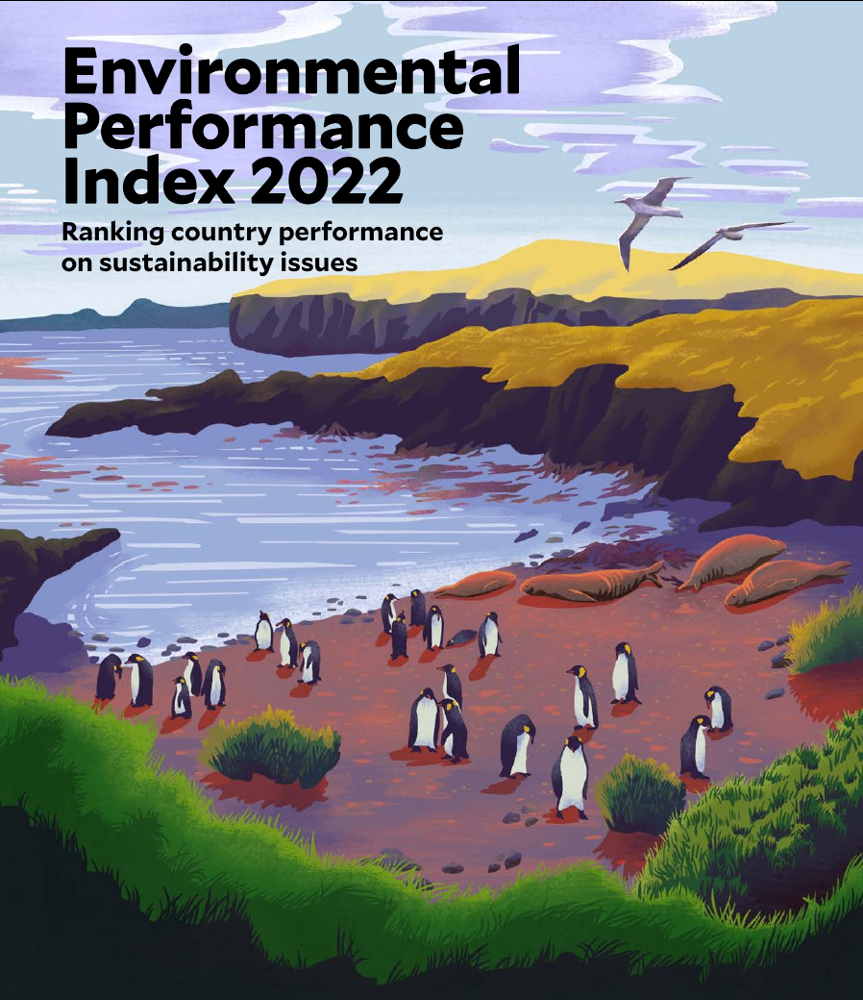

Niels Souffir, Giorgi Kupradze, Martin Loup

# pydata_ENSAE
Projet du cours 'Python pour la Datascience' de l'ENSAE Paris



Nous utilisons un dataset fourni par la NASA, intitulé **"2022 Environmental Performance Index (EPI)"**.
Lien vers le dataset: [EarthDATA/NASA/EPI](https://www.earthdata.nasa.gov/data/catalog/sedac-ciesin-sedac-epi-2022-2022.00)

## Comment faire tourner notre code?
1. Installer les dépendances en une commande:
```bash
pip install -r requirements.txt
```

2. Installer les données brutes du site [EarthDATA/NASA/EPI](https://www.earthdata.nasa.gov/data/catalog/sedac-ciesin-sedac-epi-2022-2022.00) dans ./raw_data/ (installer le fichier zip intitulé **2022-epi-raw-data-time-series-na-csv.zip**)

3. Extraire les données dans le même dossier

4. Faire tourner le fichier python principal:
```bash
python3 main.py
```

## Notre motivation
Au-delà de la vérification du travail qui a déjà été effectué pour comparer les efforts des différents pays, nous voulons mettre en valeur les efforts faits par certains pays pauvres quant à leurs problèmes environnementaux présents. En effet, améliorer la qualité de l'air est une nécessité immédiate, tandis que la réduction des émissions des GES est un luxe que seuls les pays riches peuvent se permettre puisqu'ils n'ont pas de contraintes d'action immédiate. On ne prend par contre pas en compte le PIB/hab. 

## Notre méthode de calcul du nouveau indicateur

## Plan détaillé des tâches à réaliser:

- [x] Trouver le sujet et le dataset, télécharger les données CSV
- [x] Compléter le squelette de la branche main
- [x] Se partager les tâches et passer chacun sur sa branche
    -> Giorgi: 
            * [ ] Obtenir les résultats de l'article pour vérifier leur méthode
            * [ ] Ajuster la méthode de calcul pour synthétiser un indicateur de la qualité de vie pour les humains pour appréhender à quel point chaque pays fait des efforts pour rendre son pays plus vivable pour sa population humaine
            * [x] Récupération automatisée des données via un call API
    -> Niels:
            * [ ] Reproduire les résultats du classement des pays en fonction de leur EPI
            * [ ] Faire des graphiques illustratifs
    -> Martin:
            * [ ] Faire l'analyse des données avec la nouvelle méthode synthétisée
            * [ ] Faire une carte du monde avec geopandas, en utilisant un gradient de couleurs pour l'EPI
- [ ] Tout organiser sous la forme d'un notebook Jupyter, compléter le requirements.txt
- [ ] Envoyer le travail complété 

## Méthodologie de travail en équipe (workflow):
Une fois qu'on aura créé nos branches personnelles, nous allons faire des commits sur ces branches, avant de terminer des blocs utiles aux autres. Ces blocs (features, corrections d'erreur etc.) vont être mergés via des "Pull Requests" de Github. Le but est d'éviter de merger sa branche sur la main sans que quelqu'un d'autre ne l'ait vérifié.
[How to make a pull request on Github](https://docs.github.com/en/pull-requests/how-tos/create-pull-requests/creating-a-pull-request#creating-the-pull-request)

## Nomenclature des commits
| Commit Message Start    | Meaning                         | Commit Message Body |
|-------------------------|---------------------------------|---------------------|
| fix(directory/to/file): | fixed a bug/mistake             |                     |
| doc(idem):              | updated documentation           | short description   | 
| feat(idem):             | added a new feature             | in a few words      |
| test(idem):             | modified/added/fixed tests      |                     | 
| misc(idem):             | miscellaneous/different changes |                     | 

## Sources utilisées pour ce travail
+ Édition Markdown: https://www.markdownlang.com/
+ Nested Pie Charts with Matplotlib: https://matplotlib.org/stable/gallery/pie_and_polar_charts/nested_pie.html
+ Docu générale de Matplotlib: https://matplotlib.org/stable/
+ Geopandas docu: https://geopandas.org/en/stable/index.html
+ Geopandas interactive mapping: https://geopandas.org/en/stable/docs/user_guide/interactive_mapping.html


## Structure du projet (à compléter)

```text
pydata_ENSAE/
├── carte/                              # cartes statiques et interactives de l'EPI 2022.
│   ├── carte_epi_interactive_2022.html
│   ├── carte_epi_interactive_regions_2022.html
│   ├── carte_epi_statique_2022.png
│   └── world.geojson                   # données géographiques mondiales.
│
├── niels/                              # fichiers relatifs à la construction et à l'analyse du nouvel EPI.
│   ├── clear_indices.xlsx              # nouvelles pondérations des 26 indicateurs retenus.
│   ├── dynamique.py                    # construction de la base historique (epi officiel et nouvel epi).
│   ├── dynamique_graphique.py          # fonctions de visualisation de l'évolution du nouvel EPI.
│   └── map.py                          # génération des cartes statiques et interactives.


```